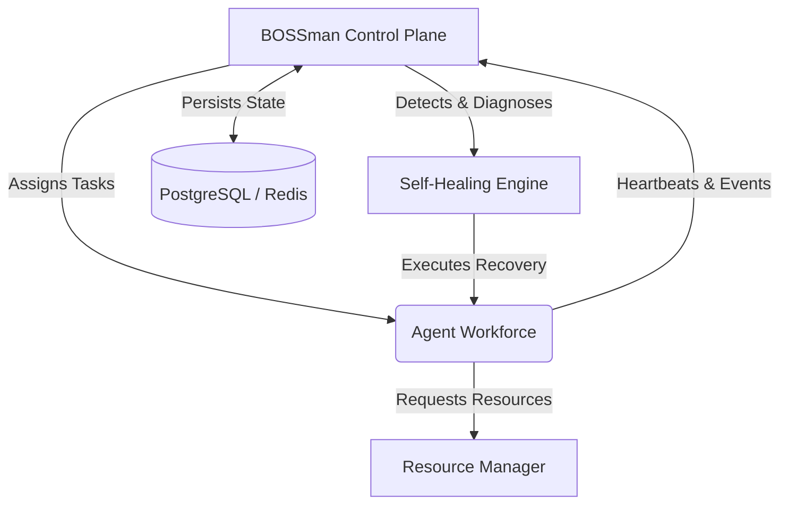
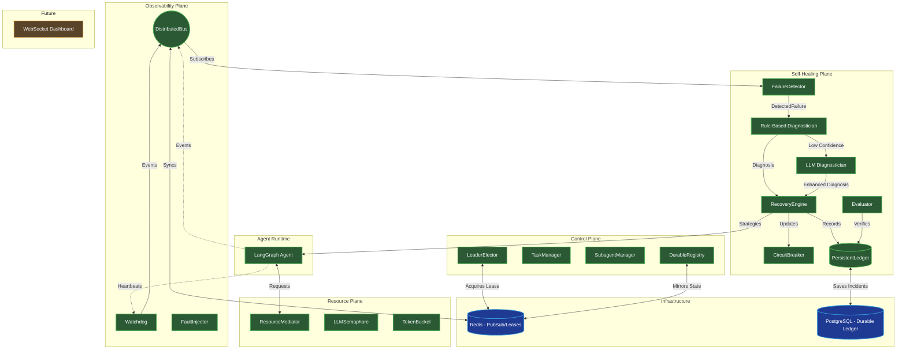

# BOSSman — Living Engineering Documentation

**Last verified phase:** Phase 9  
**Test status:** 234 passing  
**Implementation status:** Active Development (Phases 0–9 Complete)  
**Last verification:** 2026-10-05  

This is the AI Systems Engineering and Architecture handbook for BOSSman. It explains the entire system from first principles, documenting what actually exists in the repository.

---

## 1. BOSSman in One Minute

**What BOSSman is:**  
BOSSman (Backend Orchestrator & Self-healing Supervisor) is a control plane and operating system for intelligent AI agents. It sits above individual agent frameworks, treating them as fallible processes that need supervision, resource management, and automated recovery.

**What problem it solves:**  
In production, multi-agent systems fail unpredictably: they deadlock on shared resources, get trapped in retry storms against rate-limited APIs, exhaust their context windows, or silently degrade in quality. Standard frameworks don't natively solve orchestration-level resilience.

**Why it exists:**  
To prevent cascaded failures across an agent workforce and ensure deterministic, verifiable recovery without relying purely on LLM self-correction.

**BOSSman vs. LangGraph:**  
LangGraph manages the internal state machine (the *process*) of a single agent. BOSSman manages the *workforce* (the *operating system*). BOSSman does not care how the agent thinks; it cares whether the agent is healthy, making progress, and not hoarding resources.

### Simple Architecture



---

## 2. The Core Mental Model

BOSSman maps operating system concepts to AI agent supervision.

| OS Concept | BOSSman Concept | Implemented? |
| :--- | :--- | :--- |
| Process | Agent (LangGraph/BaseAgent) | ✅ Yes |
| Process scheduler | TaskManager | ✅ Yes |
| Process table | DurableRegistry | ✅ Yes |
| Watchdog | Watchdog (Stagnation detection) | ✅ Yes |
| Semaphore | LLMSemaphore (Concurrency cap) | ✅ Yes |
| Rate limiter | TokenBucket (Throughput cap) | ✅ Yes |
| Mutex / lock | ResourceMediator (Exclusive access)| ✅ Yes |
| Deadlock | Agent/resource deadlock detection | ✅ Yes |
| IPC | DistributedBus (Redis) | ✅ Yes |
| Process failure | Agent failure (STUCK/FAILED) | ✅ Yes |
| Restart | Agent recovery (10 strategies) | ✅ Yes |
| HA / Active-Passive | LeaderElector (Redis leases) | ✅ Yes |

---

## 3. Full Architecture



---

## 4. System Planes

### Infrastructure Plane (Phase 9)
Provides distributed HA state.
- **LeaderElector**: Ensures only one node acts as the supervisor (Watchdog/Detector) across a cluster.
- **DurableRegistry**: Redis-backed agent process table.
- **PersistentLedger**: PostgreSQL-backed recovery audit trail.

### Control Plane
Manages workforce state.
- **TaskManager**: Distributes tasks, tracks retries, and maintains the Dead Letter Queue (DLQ).
- **SubagentManager**: Prevents duplicate spawns via idempotency keys.

### Observability Plane
Handles telemetry and system vitals.
- **DistributedBus**: Redis-backed pub/sub broker for cluster-wide IPC.
- **Watchdog**: Scans the Registry for stale heartbeats.

### Self-Healing Plane
Implements the Detect → Diagnose → Recover → Verify loop.
- **FailureDetector**: Uses sliding windows over EventBus streams to detect anomalies.
- **Diagnostician**: Maps failures to root causes and recovery strategies using rules.
- **LLMDiagnostician**: Augments rule-based diagnosis for novel failures.
- **RecoveryEngine**: Executes actions (restart, circuit break, escalate).
- **Evaluator**: Verifies recovery success via L1-L4 health checks.

### Resource Plane
- **LLMSemaphore**, **TokenBucket**, **ResourceMediator**: Coordinates rate limits and concurrent access to APIs and datasets.

---

## 5. Phase-by-Phase Status

| Phase | Purpose | Status | Important Components |
| --- | --- | --- | --- |
| 0 | Agent Contract | ✅ Done | `AgentState`, `BossmanEvent` |
| 1 | BOSSman Core | ✅ Done | `EventBus`, `Registry`, `Watchdog` |
| 2 | Real Agent | ✅ Done | `BaseAgent`, `ResearchAgent` |
| 3 | Resource Mgr | ✅ Done | `LLMSemaphore`, `TokenBucket` |
| 4 | Detection | ✅ Done | `FailureDetector`, `Diagnostician` |
| 5 | Recovery | ✅ Done | `RecoveryEngine`, `CircuitBreaker` |
| 6 | Evaluator | ✅ Done | `Evaluator`, `HealthChecker` |
| 7 | LLM Diagnosis | ✅ Done | `LLMDiagnostician` |
| 8 | REST API | ✅ Done | FastAPI integration (`/api/cluster`) |
| 9 | Distributed HA | ✅ Done | Redis, PostgreSQL, Leader Election |
| 10 | Policy/Trust | 🔜 Next | RBAC, Sandboxing, Namespaces |

---

## 6. Repository Map

```text
bossman/
├── backend/                 # Python Control Plane & Agent Logic
│   ├── agents/              # Phase 2: Agent runtime
│   ├── api/                 # Phase 8: FastAPI server & runtime wiring
│   ├── contracts/           # Phase 0: System boundaries & data models
│   ├── core/                # Phase 1: Orchestration & memory layers
│   ├── detection/           # Phase 4/7: Anomaly detection
│   ├── evaluation/          # Phase 6: Post-recovery verification
│   ├── infra/               # Phase 9: Durable distributed infrastructure
│   ├── recovery/            # Phase 5: Action execution & strategies
│   ├── resources/           # Phase 3: Contention management
│   └── tests/               # 234 passing unit/integration tests
├── frontend/                # React/Vite Dashboard (UI)
│   ├── src/components/
│   ├── src/pages/
│   └── src/types.ts
├── scratch/                 # Local dev/test scripts (ignored in git)
├── docker-compose.yml       # Phase 9 infrastructure (Redis/Postgres)
└── README.md
```

---

## 7. High Availability & Distributed Operation (Phase 9)

BOSSman can run in two modes controlled by `BOSSMAN_MODE`:

1. **`standalone`**: Single-process, in-memory. Perfect for local testing with 1-4 agents.
2. **`distributed`**: 
   - Connects to **Redis** for Pub/Sub events (`DistributedBus`).
   - Uses Redis for `LeaderElection` (only one node runs the Watchdog/Detector).
   - Backs `DurableRegistry` to Redis hash maps.
   - Saves all `RecoveryLedger` incidents to **PostgreSQL** for permanent auditing.
   - *Requires running `docker-compose up` to start infra.*

---

## 8. Current System Capabilities

### BOSSman CAN currently:
- Run in a distributed HA cluster across multiple servers.
- Elect a leader to avoid duplicate supervision/recovery actions.
- Persist agent states to Redis and incidents to PostgreSQL.
- Register agents and track heartbeat telemetry.
- Prevent duplicate agent spawns via idempotency keys.
- Manage exclusive resources, concurrency caps, and rate limits.
- Detect deadlocks via cycle detection in wait-for graphs.
- Detect retry storms and context overflows via sliding windows.
- Map failures to 10 distinct recovery strategies.
- Fall back to an LLM for novel failure diagnosis.

### BOSSman CANNOT currently:
- Ensure deep security isolation between agents (Phase 10: Policy & Isolation).
- Serve the visual React Flow dashboard (UI is built but endpoints need mapping).
- Scale agents via external orchestrators like Kubernetes automatically (Phase 12).

---

## 9. Architecture Decisions

- **Why EventBus?** Tight coupling between a Watchdog and a RecoveryEngine causes spaghetti code. Pub/sub isolates detection from recovery.
- **Why Redis for HA?** Redis Pub/Sub provides low latency IPC, and its atomic operations (SET NX) allow for safe, lease-based leader election.
- **Why deterministic rules before LLM?** Cost, speed, and reliability. 90% of system failures (timeouts, out-of-memory) are well understood. LLMs are reserved for the 10% edge cases (novel tool hallucinations).
- **Why context compaction?** Context isn't infinite. Treating it as a system resource (like RAM) allows BOSSman to trigger "Garbage Collection" (compaction) before an API hard-fails.
