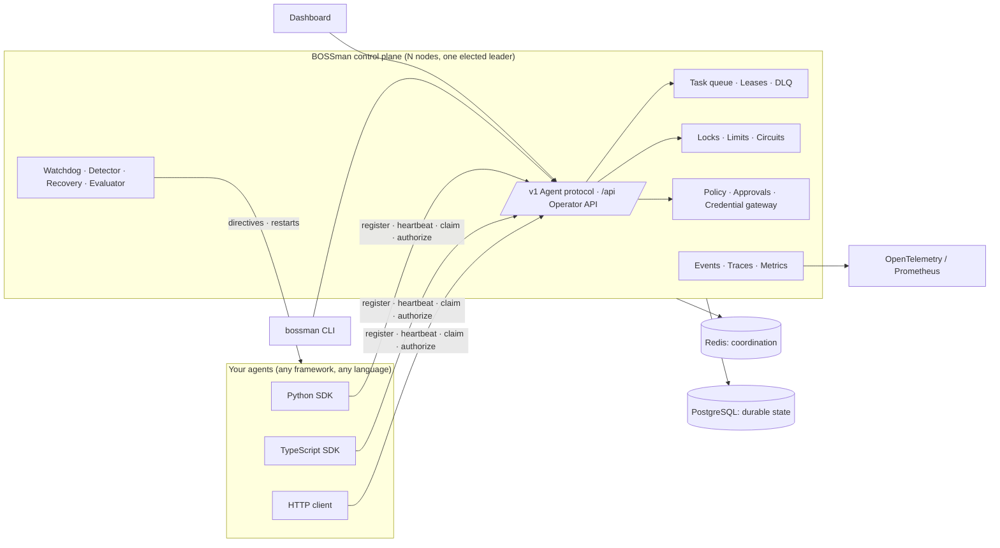

<div align="center">

# BOSSman

**The control plane for AI agent fleets.**

Supervision, self-healing, resource arbitration and governance for production multi-agent systems:
self-hosted, framework-agnostic, and deployable like any other piece of infrastructure.

`Python SDK` · `TypeScript SDK` · `HTTP API` · `Docker` · `Kubernetes (Helm)` · `PostgreSQL` · `Redis`

</div>

---

## Overview

Production agent systems fail in ways conventional software does not. They loop silently, exhaust their context windows, spawn duplicate workers that deadlock on shared resources, hammer rate-limited APIs, degrade in quality without raising an error, and occasionally take irreversible actions faster than a human can intervene.

BOSSman treats agents the way an operating system treats processes. Agents written in any framework (LangGraph, CrewAI, the OpenAI Agents SDK, the Claude Agent SDK, or plain code) connect to BOSSman over HTTP. BOSSman then **schedules their work, watches their health, arbitrates shared resources, enforces what they may do, and recovers them automatically when they fail.** It does not care how an agent reasons. It cares that the agent is alive, making progress, within its budget, and within its mandate.

| Operating-system concept | BOSSman equivalent |
| --- | --- |
| Process table | Agent registry with namespaces and epoch-based fencing |
| Scheduler | Leased task queue with priorities, dependencies, retries and a dead-letter queue |
| init / systemd | Managed mode: BOSSman launches agent processes or containers and restarts them |
| Signals | Directives: `PAUSE`, `RESUME`, `ABORT_TASK`, `COMPACT_CONTEXT`, `ROLLBACK_CHECKPOINT`, `FALLBACK_MODEL`, `RESTART`, `SHUTDOWN` |
| Mutex, semaphore, rate limiter | Leased locks with deadlock detection; fleet-wide concurrency and token-bucket limits |
| Permissions and `sudo` | Permission tiers, policy engine, human approvals, credential gateway |
| Watchdog, OOM killer | Heartbeat timeouts, no-progress detection, context-overflow and token-burn detectors |

## Capabilities

**Supervision and recovery**
- Heartbeat watchdog, stagnation detection, and fencing tokens that stop a superseded process from acting.
- Detect → diagnose → recover → verify loop: a deterministic rule engine, with an optional LLM diagnostician for novel failures.
- Ten recovery strategies, including real process, Docker and Kubernetes restarts, task reassignment, checkpoint rollback, circuit breaking, model fallback, context compaction, forced lock release and human escalation.
- Erlang/OTP-style supervision trees (`one_for_one`, `one_for_all`, `rest_for_one`) with restart budgets that escalate to the parent supervisor.

**Durable work**
- Lease-based task claims with fencing. If a worker dies, its lease expires and the task is retried elsewhere.
- Transient failures retry with exponential backoff and full jitter. Non-transient failures fail fast to the dead-letter queue.
- Task dependencies with **cascade containment**: downstream work is quarantined instead of consuming poisoned input.
- JSON-Schema output validation, resumable checkpoints, idempotency keys and exactly-once side effects.

**Shared resources**
- Named locks acquired atomically in a global order, with wait-for-graph deadlock detection and TTL leases.
- Cluster-wide concurrency caps and rate limits (a built-in `llm` limit gates every model call in the fleet).
- Shared circuit breakers, so the whole fleet fails fast on a degraded dependency.

**Governance**
- Every side-effecting action is authorised by a policy engine. The checks are tier ceilings, declared capabilities, rules, irreversibility and kill switches.
- Human approvals with an N-person rule; unanswered requests expire and are denied by default.
- Credential broker and HTTP tool gateway: secrets are encrypted at rest and injected server-side, so agents never hold production credentials.
- Namespaced API keys stored only as hashes. A complete audit trail of decisions, approvals and operator actions.

**Observability and quality**
- Real-time dashboard: fleet topology, agents, tasks, incidents, approvals, operations, governance and traces.
- One causal trace per pipeline (W3C trace context), exportable through OpenTelemetry to Jaeger, Langfuse, LangSmith or Datadog.
- Prometheus metrics, liveness and readiness probes.
- Leading-indicator monitoring: token-burn anomalies, API-rate spikes, queue backlog, DLQ growth and spawn storms.
- Known-answer probes and quality scores (optionally LLM-judged) to catch silent degradation.

## Architecture



A single node runs entirely in memory for development. In production, nodes share Redis (coordination, events, locks, leader election) and PostgreSQL (tasks, ledger, keys, approvals, policies, events). Any node serves the API; the elected leader runs supervision duties and fails over within a lease interval.

## Quick start

**1. Start the control plane**

```bash
git clone https://github.com/<your-org>/bossman.git && cd bossman
cp .env.example .env              # set tokens and BOSSMAN_SECRET_KEY
docker compose up -d --wait       # API + dashboard at http://localhost:7070
```

**2. Connect an agent**

```bash
pip install -e sdk/python         # bossman-sdk and the `bossman` CLI
export BOSSMAN_URL=http://localhost:7070
export BOSSMAN_API_KEY=<BOSSMAN_AGENT_TOKEN from .env>
```

```python
import asyncio
from bossman import Bossman

async def handle(task):
    async with agent.limit("llm"):                      # fleet-wide LLM gate
        answer = await call_model(task.input["question"])
    agent.report(tokens=1200, context=0.31)             # telemetry for the watchdog
    await task.checkpoint("answered", {"chars": len(answer)})
    return {"answer": answer}                           # validated against the task's output_schema

async def main():
    global agent
    async with Bossman() as bm, bm.agent(name="researcher-1", role="researcher") as agent:
        await agent.serve(handle)

asyncio.run(main())
```

**3. Send work and operate the fleet**

```bash
export BOSSMAN_TOKEN=<BOSSMAN_ADMIN_TOKEN>
bossman task submit "Summarise Q3 filings" --role researcher --input '{"question": "..."}' --wait
bossman status          # fleet health
bossman approvals       # actions awaiting a human
bossman events -f       # live event stream
```

The dashboard's **Get started** page has connect snippets for Python, TypeScript, LangGraph, raw HTTP and managed mode.

## Deployment

| Target | Command | Notes |
| --- | --- | --- |
| Local, zero dependencies | `pip install -e "backend[dev]" && bossmand serve` | In-memory. Add `BOSSMAN_PERSISTENCE=sql DATABASE_URL=sqlite+aiosqlite:///bossman.db` for durability. |
| Docker Compose | `docker compose up -d --wait` | BOSSman + Redis + PostgreSQL, bound to `127.0.0.1`. |
| High availability | `docker compose --profile ha up -d --wait` | Two nodes with leader election. |
| Kubernetes | `helm install bossman deploy/helm/bossman` | HA Deployment, migrations init container, RBAC for pod-level recovery, optional bundled datastores, ingress, PDB, ServiceMonitor, and agent Deployments declared in `values.yaml`. |

All configuration is through environment variables; [`.env.example`](.env.example) documents every option.

## SDKs and API

| Interface | Location | Highlights |
| --- | --- | --- |
| Python SDK | [`sdk/python`](sdk/python) | `agent.serve`, locks, limits, circuits, `call_tool` compensation, `authorize` / `proxy`, `once`, degradation ladder, probes, LangGraph and MCP integrations, synchronous `bossman.run()` |
| TypeScript SDK | [`sdk/typescript`](sdk/typescript) | Zero dependencies, Node 18+, `AbortSignal`-aware task handlers |
| CLI | `bossman` (ships with the Python SDK) | Fleet, tasks, DLQ, approvals, flags, keys, secrets, policies, managed agents, events, traces |
| Daemon | `bossmand` | `serve`, `migrate`, `keys`, `check` |
| HTTP API | `/v1/*` agent protocol, `/api/*` operator API | OpenAPI spec at `/api/openapi.json` (interactive docs at `/api/docs` outside production) |

## Security

- **Authentication:** bearer tokens. Bootstrap tokens come from the environment; scoped API keys are created at runtime and stored only as SHA-256 hashes.
- **Authorisation:** four roles (`viewer`, `agent`, `operator`, `admin`). Agent keys are namespace-scoped and carry a maximum permission tier, so an agent can never register above its ceiling.
- **Enforcement at the infrastructure layer:** policy decisions are made by BOSSman, not by agent prompts. Irreversible actions require a justification and human approval.
- **Secrets:** encrypted at rest with `BOSSMAN_SECRET_KEY`. In proxy mode, values never leave the control plane. Managed agents never inherit control-plane credentials.
- **Production mode** (`BOSSMAN_ENV=production`) makes reads private and disables interactive API docs. Terminate TLS in front of BOSSman before exposing it beyond a trusted network.

## Repository layout

```
backend/            bossman-server: API, control plane services, detection, recovery, migrations, tests
sdk/python/         bossman-sdk (Python) and the bossman CLI
sdk/typescript/     @bossman/sdk (TypeScript)
frontend/           React dashboard, served by the API in production
deploy/helm/        Helm chart
examples/           Runnable agents: quickstart, pipeline, governance, managed, chaos, LangGraph, TypeScript, Kubernetes
Dockerfile          Single image: API, dashboard, CLI
docker-compose.yml  Local and HA stacks
```

## Development

```bash
pip install -e "backend[dev]" -e sdk/python
cd backend && pytest                                   # unit and end-to-end suites
docker compose up -d --wait redis postgres
pytest -m integration                                  # against real Redis and PostgreSQL

cd frontend && npm ci && npm run dev                   # dashboard on :3010, proxied to the API on :7070
cd sdk/typescript && npm ci && npm test                # set BOSSMAN_URL and BOSSMAN_API_KEY for live tests
```

The design rationale (failure taxonomy, supervision trees, circuit breakers, the degradation ladder) is documented in `context/zylos.md`. Historical phase notes are in [`old_readme.md`](old_readme.md).

## Status

Version **0.2.0**. Phases 0–15 are complete: agent contract, core supervision, resource management, detection, recovery, evaluation, LLM diagnosis, dashboard, distributed high availability, the agent protocol and SDKs, durable work, packaging, governance, managed mode, and observability.
